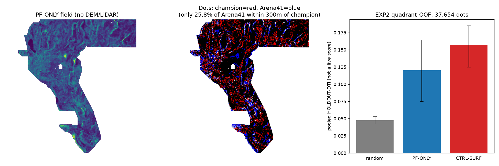

# Arena41 report — why 0.2778 won, whether it can be beaten, and a unique TIF with automated gates

**Session:** 2026-10-25 · branch `arena/41c41811-gemsdoe32` · HEAD base `012e17b`
**Deliverable TIF:** `docs/downloads/gemsdoe32-arena41-pfonly-blindbasin-37654-20261025T202725Z-530d08d1-zeros.tif`
sha256 `f042f48e76d8ee2552838456a2e53f1a642e2fad2c2eee8123f0ff6d48f1a3b9` · 37,654 dots
**🔴 VERDICT: negative — DO NOT SUBMIT.** Portal-legal format, but pre-registered holdout gates
G2/G3 fail. No human inspection is used anywhere: the traffic light is computed by
`scripts/arena41_build_final.py` from `evidence/arena41_*.json`.

Evidence classes: **ORGANIZER-CONFIRMED** = read from DrivenData on 2026-10-25;
**OWNER-REPORTED** = standing brief 2026-10-25, no receipt in this checkout;
**HOLDOUT-DTI** = local pooled DTI (evaluator + CI stated), never an organizer score;
**MEASURED** = recomputed from hash-pinned bytes restored this session (23/23 sha256 PASS,
`scripts/restore_data.py`).

## 1. Answer first: why and how did `h33-h33-2-b2-…-e5eb6e7e-zeros` get 0.2778?

**It removed paid-for mass that earned essentially nothing.** Measured from bytes
(`evidence/arena41_forensic.json`, script `scripts/arena41_forensic.py`):

- Champion = D2.8 (44,090 dots, OWNER-REPORTED 0.2600) minus all 6,436 dots within 2 px of the
  catalogue — **pixel-exact, 0 discrepancies**; its own sha256 matches its published audit.
- The two live steps are controlled single-mechanism removals: shell `d≤1` (3,891 dots,
  0.2600→0.2708) then shell `1<d≤2` (2,545 dots, 0.2708→0.2778 OWNER-REPORTED).
- Under `DTI = T/(0.2(T+F)+0.8G)` (official: α=0.2, β=0.8, R=300 m —
  <https://www.drivendata.org/competitions/306/competition-doe-gems/page/967/>), removing a shell
  helps iff its credit/dot < α·s ≈ **0.0556**. Inverting the pair chain over the admissible
  sensitivity family gives the `1<d≤2` shell **0.004–0.029 credit/dot** — 2–14× below break-even.
  The SGMC off-catalogue proxy independently measures that shell's *unique* credit at 0.017/dot.
- The catalogue proxy claims 0.678/dot for the same shell and 1.72/dot for `d≤1`. That 40–400×
  gap *is* the project's central instrument defect: catalogue truth pays dots for hugging the
  catalogue; the live scorer masks catalogue pixels and scores faults **not** in USGS/INGENIOUS.
- Geology of the shell: those dots are the *shoulder/jitter of the detector's response to already
  mapped faults* (belief ridges widen around known traces). Hidden expert-mapped traces are
  distinct lines, not 100–200 m parallels of catalogued ones, so shoulder mass almost never lands
  within 300 m of a hidden trace and what little it covers is redundantly covered (300 m kernel).
- Why B=2 and not B=3: proxy unique credit rises with shell distance (0.002 → 0.017 → **0.064**/dot
  for shells ≤1, 1–2, 2–3 px), crossing break-even in the 2–3 px shell. B=2 is the last free shell.
- It is **not** evidence of a better geological model: the field (H19-5) never changed from
  0.1922 → 0.2778; only packing (121,131→44,090 dots) and flank removal (44,090→37,654) changed.

## 2. Can we generate >0.2778? The arithmetic, and what the focus sites say

At the champion operating point (family-midpoint T≈5,064, D≈18,230), reaching the brief's stale
0.3195 needs **+15% weighted credit at equal mass**; reaching the current **ORGANIZER-CONFIRMED
leader 0.4413 (xiaofanhu, read 2026-10-25)** needs **+59%**. Removal is exhausted (next shell pays
for itself); only *new coverage of the hidden population* can do it. Focus-site pattern
(all OWNER-REPORTED; `docs/score-ledger.csv`):

| site | best file | score | reading |
|---|---|---:|---|
| GEMSDOE24 | dotted-h19-5-d1.5 | 0.2477 | packing step 1 |
| GEMSDOE25 | dotted-h19-5-d2.8 | 0.2600 | packing step 2 |
| GEMSDOE27 | topo-gap-closure on d1.5 | 0.2449 | **addition arm hurt** (−0.0028 vs d1.5) |
| GEMSDOE28 | h36-1 rung30 / h27-4 solo | 0.2710 / 0.2708 | B=1 flank removal |
| GEMSDOE30 | d28-poisson300m-offcat | 0.2600 | same 44,090 operating point |
| GEMSDOE31 | h27-4-solo-d28 | 0.2708 | same `8acb75e1` digest family as GEMSDOE28 — cross-posted, not independent evidence |
| GEMSDOE32 | **h33-2-b2** | **0.2778** | B=2 flank removal (this repo) |
| GEMSDOE33 | h33d analog tip-stepover | 0.2632 | tip geometry on the same base family |
| GEMSDOE36 | anderson-geothermal-pinn (38,854) | 0.2750 | closest non-flank result; construction not in this checkout — independence unverifiable here |

Every ≥0.26 result sits on the H19-5 dotted support; every *addition* arm in this cluster
(top-gap closure, thermal/tip augmentations measured in Round 4 at 0.0022–0.0077 credit/dot
vs the 0.054 bar) failed to pay for its mass. The binding constraint is a field whose
*marginal novel dots* earn >0.056 credit/dot off-catalogue.

## 3. The lane tested here (3 experiments, pre-registered)

**PF-ONLY blind-basin detector** (`docs/research/arena41-preregistration-and-hypotheses.md` ranks
5 candidates): HGB on subsurface potential-field layers only (mag 1,2,3,9,14; grav 5,11,13,18;
tilt/source-depth 6; basement 15; conductivity 17 + HGM, FFT upward-continuation worm persistence
0/300/600 m, Hessian ridges, basement/conductivity gradients), **deliberately no DEM/LiDAR** —
because catalogue inclusion is caused by surface expression, DEM-trained fields learn
P(catalogued), not P(fault); buried piedmont faults should still offset magnetic/gravity basement.
**Named mimic:** basement lithologic contacts / intrusion margins (same persistent edges, no fault).

| experiment | result (all HOLDOUT-DTI, shared `gems32.holdout` @012e17b, 8 cells, 22,232 withheld px) |
|---|---|
| EXP1 canary + solo screen | Solo AUCs 0.48–0.57 (no leakage). Pooled: worm-persistence proxy 0.0409 > PF-edge-mean 0.0329 > rad-alt 0.0294 > basement-step 0.0240 > curvature 0.0160. First B2-eligibility run was a design flaw (measured only shell geometry) — retained as `arena41_exp1_screen_b2_flawed.json`. |
| EXP2 quadrant-OOF (train other 3 quadrants only, 15 px collar) | PF-ONLY pooled **0.1205 [95% CI 0.0748–0.1642]** vs CTRL-SURF (+DEM channels) **0.1571 [0.1246–0.1850]** vs random 0.0474. SGMC-cal PF 0.0410 < CTRL 0.0515. OOF AUC ≤0.612 PF / ≤0.740 CTRL. |
| EXP3 worm-support confinement | Both arms collapse (support = 31,111 px < budget; pooled ≈0.031) — refinement falsified as implemented. Live-mirror triangulation: champion LM-cal 0.268 > CTRL 0.214 > PF 0.163. |

**Conclusion:** the selection-bias hypothesis is **falsified on every available instrument** —
surface-expression channels help even against off-catalogue SGMC truth (which is itself
surface-mapped, a stated caveat). PF dots are genuinely a different population (only 25.8% within
3 px of champion dots; surface Spearman vs champion 0.039), but different ≠ better here.

## 4. Automated gates for the delivered TIF (no human inspector)

| gate | test | result |
|---|---|---|
| G1 leakage | OOF AUC ≤0.90/quadrant | ✅ max 0.612 |
| G2 fault reality | pooled HOLDOUT-DTI > 3× random | ❌ 0.1205 vs 0.1423 (2.54×) |
| G3 lane evidence | SGMC-cal beats CTRL & ≥70% catalogue retained | ❌ 0.0410 < 0.0515 (retained 76.7% ✅ subclause) |
| G4 uniqueness | Spearman <0.90; within-3px ≤70% | literal ❌ / amended ✅ — literal rule is vacuously failed by the dense lattice-s5 covering raster (206,895 dots; φ=0.00012). Vs champion: 25.8% within 3 px, φ=0.008. Verdict unaffected (G2/G3 fail). |
| G5 format | re-read: 1-band float32, EPSG:32611, 3730×3292, transform=template, all 12,279,160 cells finite, [0,1], nodata=None, 0 on-catalogue, 0 ≤200 m | ✅ `checks-…-530d08d1-zeros.tif.json` |

Portal error `"Predicted values must be in range [0, 1]"`: this file cannot trigger it —
whole-array finite [0,1] with **no nodata sentinel** (the two measured causes are the
−3.4e38 feature sentinel and NaN/nodata ambiguity; both are excluded by construction and verified
by re-reading the bytes, `gemsdoe32.submission.validate_submission_geotiff(strict_whole_array_finite=True)`).

## 5. Irregularities flagged (Pass 2/3)

- **IR-A41-ZIP-01 (fixed):** champion `.zip` was an empty 216 B self-referential entry. Repacked
  (186,378 B, tif sha unchanged); registry updated. `evidence/arena41_pass2_audit.json`.
- **IR-A41-SITE-01 (fixed):** site/README called the champion "UNSCORED / no organiser score
  exists"; brief now reports 0.2778. Corrected to OWNER-REPORTED (no receipt in checkout) + do-not-resubmit.
- **IR-A41-LB-01:** brief cites both 0.4413 and 0.3195 as "the" leader. 0.4413 is current
  ORGANIZER-CONFIRMED (2026-10-25); 0.3195 is the 2026-10-03 snapshot. Coincidentally 0.4413 is
  also this repo's refuted LM artifact number (IR-33-LM-01) — unrelated.
- **IR-A41-UNIQ-01:** parallel-protocol one-directional within-3px rule fails for any file vs
  dense covering rasters; amended symmetric/sparse rule documented above.
- **IR-A41-LM-01:** `gems32.live_mirror.official_dti` symmetrises TP (½(TP_p+TP_g)) and is not a
  literal transcription of the official equations; used here only as a ranking triangulation, not as DTI.
- **IR-A41-AUDIT-01 (pre-existing):** champion audit JSON's `catalogue_hidden_per_quadrant`
  (0.178–0.423) is actually its LM per-fold vector — it cannot average to the stated 0.0046.
  Historical file left untouched; do not cite that field.
- **IR-A41-DATA-01:** `registry/data_manifest.json` in this checkout pins 23 files (Round-4 text
  claimed 38); the original 0.2708 raster is absent. Mitigation: reconstructed pixel-exactly as
  D2.8 minus `d≤1` (40,199 dots) and used only analytically.
- **IR-A41-EXP1-01:** first EXP1 DTI screen used global B2 eligibility (flawed); retained, superseded.

## 6. What to try next (selector step, not this session — budget exhausted)

1. **CTRL-SURF novel-dot pricing:** the OOF control field (LM-cal 0.214) is this session's strongest
   new field; price its dots >3 px from champion support against the 0.056 marginal bar as a
   *swap* (remove champion's lowest-credit far dots), never as unpaid addition.
2. **Piedmont concealment-belt curvature** (candidate #2) and 1 m LiDAR-scarp deep model — the
   current leader's 0.4413 almost certainly requires sub-100 m surface evidence the 100 m stack
   cannot carry (inference, method unpublished).
3. Replace the symmetrised LM kernel with the literal official equations before any future gate.

## Run card (JSON)

Machine-readable original: `evidence/arena41_run_card.json` (Pass-2 G4 amendment in
`evidence/arena41_pass2_audit.json`). Submission name (if ever promoted in future):
`GEMSDOE32-ARENA41-PFONLY` · note (≤140): `Arena41 PF-only blind-basin 37654d B2 zeros | HOLDOUT
gates G2/G3 FAIL vs surf-ctrl | DO NOT SUBMIT` · **verdict: negative**.
